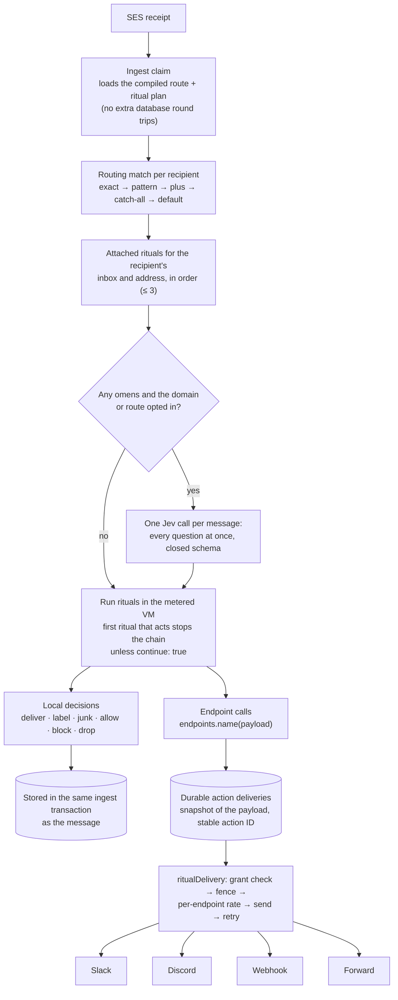
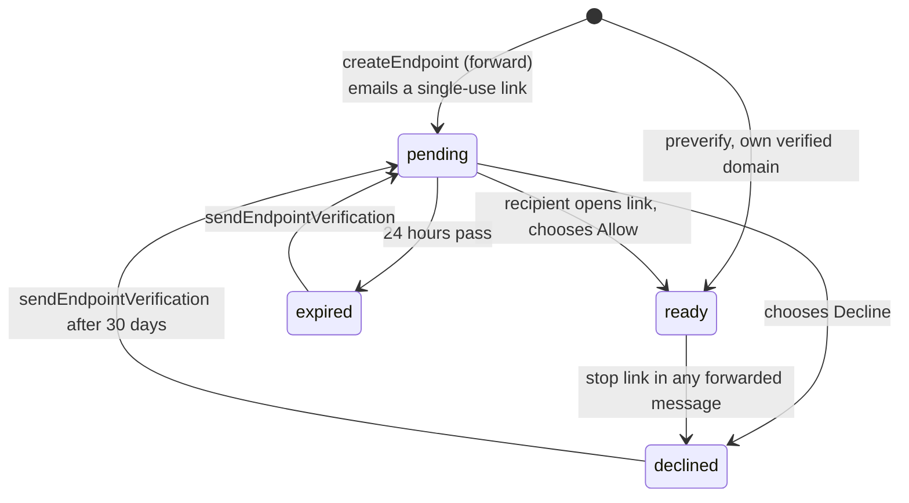

# Rituals, Endpoints and Omens

A **ritual** is a short script that runs when mail reaches an inbox or address. It reads the message and decides what happens: deliver it to another inbox, call an endpoint, label it, junk it, block it. An **endpoint** is a named Slack, Discord, webhook or forward target that rituals call by name. An **omen** is a question a ritual asks Jev about the message; the answer comes back as a plain score or boolean.


In the dashboard, rituals and endpoints are tabs of **Receiving**, next to Routes. [receiving.md](receiving.md) explains how they fit together.

- [Concepts](#concepts) and [the pipeline](#the-pipeline)
- [Language reference](#language-reference): [entry point](#entry-point), [what you can write](#what-you-can-write), [`email` and `ctx`](#email-and-ctx), [built-ins](#built-ins), [endpoints](#calling-endpoints), [omens](#omens), [sender lists](#sender-lists), [limits](#limits), [errors](#compile-errors)
- [Examples](#examples)
- [Endpoints](#endpoints): types, [forward confirmation](#forward-confirmation), [retries and rate limits](#retries-and-rate-limits)
- [API, SDK and MCP](#api-sdk-and-mcp)

## Concepts

| Thing | What it is | Where it lives |
|---|---|---|
| Ritual | A script with one default function `route(email, ctx)`. Deterministic: no clock, randomness, loops or network. | Saved by key in a versioned workspace config (`applyRituals`, `saveRitual`). |
| Attachment | Runs a ritual on mail to a target: an inbox ID (`mbx_…`) or an address. Ordered; up to three per target. | Same config (`attachRituals`). |
| Endpoint | A named target: `slack`, `discord`, `webhook` or `forward`. Credentials and URLs stay in the endpoint; scripts only name it. | `/v1/endpoints`. |
| Omen | A literal question in a ritual, such as `"Is the sender asking for a refund?"`. One Jev call per message answers every question; scripts get numbers or booleans. | Declared in the source; asked only for domains or routes opted in with `setOmenOptIns`. |
| Sender list | A named list of addresses or `@domains` for `lists.has(name, address)`. | Same config (`senderLists`). |

Routing still decides where mail goes by default (routes and inbox ownership). Rituals run on top of that decision for each recipient and can add destinations, call endpoints, or change the message's disposition. Guard is part of this: blocking, allowing and junking are ordinary ritual actions, with templates for the common rules.

## The pipeline



- A ritual error stops evaluation for that recipient. Nightmail discards pending ritual actions, marks the message as junk with `ritual-error`, and uses the existing junk delivery rules. Ritual text and regex operations inspect at most the first 65,536 characters. A regex test also spends one step for every 64 bytes of matcher state it builds; a pattern that needs more than 512 KiB of state for a text (many wildcards in a row, for example) is a ritual error for that message, so prefer `includes`, anchors and specific words over long runs of `.`.
- Local decisions commit with the message, so nobody sees mail before its final disposition. External calls are queued only after that commit.
- A dry run (`testRituals`) runs the same pipeline on a stored message or pasted MIME inside a rolled-back transaction. It never delivers, never calls Jev and never saves; pass `scores` (or set answers in the dashboard) to see what an omen answer would do.

### Stepping through a dry run

Each trace row has a `timeline`: the evaluation in the order it happened, at most 128 steps. Dry runs record it; delivery never does.

| Step | Fields | Meaning |
|---|---|---|
| `condition` | `line`, `column`, `endLine`, `endColumn`, `result` | An `if` or `?:` test, its source span and what it evaluated to. |
| `omens` | `line`, `scores` | The omen answers the ritual read: the `scores` you passed, recorded answers, or each omen's `onError` value. |
| `action` | `line`, `op`, `ref?`, `value?` | `label`, `junk`, `block`, `drop`, `allow`, `inbox.deliver` (`ref: inbox:<key>`) or an endpoint call (`ref: endpoint:<name>`). |
| `return` | `line` | The `return` that ended the ritual. |

For this ritual and a refund request, with the omen answered `0.9`:

```js
const QUESTIONS = { refund: "Is the sender asking for a refund?" }

export default function route(email, ctx) {
  if (email.headers.has("list-unsubscribe")) return junk("newsletter")
  const result = omens(email, QUESTIONS)
  if (result.refund >= 0.7) {
    label("refund")
    inbox.deliver("billing")
  }
  endpoints.support({ text: `${email.from.address}: ${email.subject}` })
}
```

```json
[
  { "kind": "condition", "line": 4, "column": 7, "endLine": 4, "endColumn": 44, "result": false },
  { "kind": "omens", "line": 5, "scores": { "refund": 0.9 } },
  { "kind": "condition", "line": 6, "column": 7, "endLine": 6, "endColumn": 27, "result": true },
  { "kind": "action", "line": 7, "op": "label", "value": "refund" },
  { "kind": "action", "line": 8, "op": "inbox.deliver", "ref": "inbox:billing" },
  { "kind": "action", "line": 10, "op": "endpoint", "ref": "endpoint:support" }
]
```

The dashboard animates it. **Trace** (Receiving → Trace) runs a recent email, a sample or a pasted message through the saved config. **Try it** in the editor runs only the ritual you're writing, unsaved, as if it were attached to the address the email was sent to, with a slider per omen (default 0.5). Conditions light up true or false in the source one at a time, omen scores fill in, then the actions and where the mail ends up. Reduced motion shows the result at once.


## Language reference

### Entry point

```js
export default function route(email, ctx) {
  // one run per recipient
}
```

The parameters are always `email` and `ctx` (`ctx` is optional). Top-level `const` is allowed only for literal omen sets: `const QUESTIONS = { refund: "Is this a refund request?" }`.

### What you can write

| Allowed | Not available (and the compile error says why) |
|---|---|
| `const name = …` (one per statement) | `let`, `var`, assignment, `++` |
| `if` / `else`, `cond ? a : b`, `return` | loops, `switch`, `try`, `throw` |
| `===` `!==` `<` `<=` `>` `>=` `+` `&&` `\|\|` `??` `!` | `==`, `!=`, other operators |
| Strings, numbers, `true`/`false`/`null`, template strings, arrays, record literals | functions, classes, `new`, `await`, spread, destructuring |
| `text.includes(x)`, `.startsWith`, `.endsWith`, `.toLowerCase()`, `.toUpperCase()`, `.trim()`, `.length` | other methods (`split`, `map`, …) |
| `/pattern/flags.test(text)` (RE2: linear time, flags `imsu`, no `{n,m}`) | regex literals used any other way |
| `email.x.y`, `email.to[0].address`, `email["field"]` | computed lookups like `value[key]` |

### `email` and `ctx`

`email` is the parsed message. Field access is checked when you save: `email.subjet` fails with *Did you mean email.subject?*

| Field | Type | Notes |
|---|---|---|
| `subject`, `text`, `visibleText`, `html` | string | `visibleText` drops hidden content (64 KiB max). `html` is sanitized or `null`. |
| `from` | `{ name, address, local, domain }` | `name` is unverified unless `auth.fromVerified`. |
| `to`, `cc`, `replyTo` | arrays of the same shape | |
| `envelope` | `{ from, to[] }` | SMTP envelope. |
| `auth` | `{ fromVerified, spf, dkim, dmarc }` | `fromVerified` is true when DMARC-aligned SPF or DKIM authenticates the From domain. Verdicts are `pass`, `fail`, `gray` or `none`. |
| `spam` | `{ ses, junk, reason }` | `junk` is Nightmail's verdict so far. |
| `flags` | `{ automated, autoReply, bulk, listId, baneHops }` | |
| `thread` | `{ id, isReply, inReplyTo, references[] }` | |
| `attachments`, `images` | `{ id, filename, contentType, size, inline, isImage, safe, … }[]` | Metadata only; content never reaches a ritual. |
| `links` | string[] | Visible links. |
| `headers` | use `email.headers.get(name)`, `.getAll(name)`, `.has(name)` | Names are case-insensitive. |
| `id`, `messageId`, `date`, `receivedAt`, `size`, `parsed`, `truncated` | | |

`ctx` describes the recipient this run is for: `recipient`, `local`, `host`, `subaddress`, `route.id`, `route.tier`, `defaults` (destinations routing chose), `junk`, `now` (receipt time; there is no clock).

The full, typed list for your workspace (including your endpoint names, inbox keys and lists) is `getRitualTypings`; the dashboard editor uses it for completions.

### Built-ins

| Call | Effect |
|---|---|
| `block(reason?)` | Reject for this recipient. Nothing is stored or delivered for it. |
| `drop(reason?)` | Discard for this recipient without storing it. |
| `junk(reason?)` | Store as junk. Webhooks without junk include skip it. |
| `allow()` | Clear the junk flag. Ignored unless `email.auth.fromVerified`. |
| `label(name)` | Add a label (up to 10; letters, digits, `:`, `-`, `_`). |
| `inbox.deliver(key)` | Also deliver to the inbox with this key. |
| `endpoints.<name>(payload?)` | Call an endpoint ([below](#calling-endpoints)). |
| `omens(email, { name: question })` | Ask Jev ([below](#omens)). |
| `lists.has(list, address)` | True when the list has the address or an `@domain` that covers it. |
| `addr.matches(address, pattern)` | Glob on addresses: `"*@example.com"`, `"billing+*@acme.io"`. |
| `text.snippet(text, maxChars)` | First `maxChars` characters (≤ 4,096). |

The first ritual that takes an action stops the chain for that target unless its attachment sets `continue: true`.

### Calling endpoints

Every endpoint is called the same way, by name; its type decides the payload, and the payload is checked when you save.

| Type | Call | Payload |
|---|---|---|
| `slack` | `endpoints.support({ text: "…" })` | Plain text. Mentions, markup and link previews are off. |
| `discord` | `endpoints.alerts({ content: "…" })` | Plain text. Mentions are off. |
| `webhook` | `endpoints.crm({ … })` or `endpoints.crm()` | Any record. It arrives as `data.ritualBody` in a signed Nightmail event, with `Idempotency-Key`. |
| `forward` | `endpoints.team()` | None: it forwards this message as text from the receiving address. |

Hyphenated names use quotes: `endpoints["support-hook"]({ … })`. A script can never contain a URL or credential; saving fails if it does. An endpoint must exist (and a forward must be confirmed) before a ritual that calls it can be saved. Each endpoint can be called at most three times per recipient of a message.

### Omens

```js
const result = omens(email, {
  refund: "Is the sender asking for a refund?",                                  // score 0–1
  urgent: { prompt: "Does this need a reply today?", type: "boolean", threshold: 0.8 },
})
if (result.refund >= 0.7) label("refund")
if (result.urgent) endpoints.oncall({ text: email.subject })
```

- Questions are literal text, fixed when you save, so a message cannot change what is asked. Answers are plain data: use them in any condition.
- Jev sees the subject, sender, authentication verdicts and up to 8,000 characters of visible text, framed as untrusted evidence. It answers only the declared questions with a closed schema.
- Omens are asked only for opted-in receiving domains or routes. Their attachments may reference at most ten distinct questions across the plan. When Jev cannot answer, the configured `onError` applies. `"defer"` retries for up to 30 minutes from receipt creation, then marks that recipient’s message as junk with `ritual-error`.
- One call per message answers every question across every ritual (up to ten). Dry runs reuse the stored answers or the `scores` you pass, and never call Jev.

### Sender lists

```js
if (lists.has("vip", email.from.address)) allow()
```

Lists live in the config: `"senderLists": { "vip": ["ceo@example.com", "@partner.example"] }`. A list a ritual names must exist when you save.

### Limits

| Limit | Value |
|---|---|
| Source | 64 KiB per ritual, 50 rituals, 256 attachments, three per target |
| Steps | 50,000 per run, 250,000 per message |
| Actions | 32 per run; three calls per endpoint per recipient |
| Output | 64 KiB per action, 256 KiB per message |
| Omens | 10 per ritual, 10 distinct questions per message |
| Regex | 256 characters, 512 RE2 instructions, 64 Ki characters of input, 512 KiB of matcher state per test |

Measured cost on a warm plan is 4–6 µs of CPU per message for typical rituals (`BANE_BENCH=1` runs the benchmark).

### Compile errors


The editor checks as you type (`checkRitual`). Saving and dry runs report every problem at once, each with the ritual, line, column and a hint:

```json
{
  "error": {
    "code": "UNKNOWN_ENDPOINT",
    "message": "Ritual triage, line 4, column 3: No endpoint named suport. Did you mean endpoints.support? (and 1 more in error.details)",
    "details": [
      { "ritual": "triage", "line": 4, "column": 3, "message": "No endpoint named suport.", "hint": "Did you mean endpoints.support?" },
      { "ritual": "triage", "line": 6, "column": 7, "message": "email has no field subjet.", "hint": "Did you mean email.subject?" }
    ]
  }
}
```

Other examples: `slack.billing(…)` → *Endpoints are called by name, whatever their type. Write endpoints.billing({ text }).* · `for (…)` → *Loops are not available; a ritual runs once per recipient within a fixed step budget.* · `x == 1` → *Use === instead of ==.* · `endpoints.alerts({ text })` on a Discord endpoint → *call it as endpoints.alerts({ content }).*

## Examples

These are the built-in templates (`listRitualTemplates` fills in your endpoint names). Each one compiles; the test suite checks it.

**Post authenticated mail to Slack**

```js
export default function route(email, ctx) {
  if (!email.auth.fromVerified) return
  endpoints.support({ text: `New mail from ${email.from.address}: ${email.subject}` })
}
```

**Send a reshaped record to your service**

```js
export default function route(email, ctx) {
  endpoints.crm({
    sender: email.from.address,
    verified: email.auth.fromVerified,
    subject: email.subject,
    preview: text.snippet(email.visibleText, 280),
    recipient: ctx.recipient,
  })
}
```

**Forward to a team address** (the recipient confirmed by email)

```js
export default function route(email, ctx) {
  if (email.auth.fromVerified && !email.flags.bulk) endpoints.team()
}
```

**Guard: block a domain, keep VIPs, junk newsletters and failed DMARC**

```js
export default function route(email, ctx) {
  if (email.from.domain === "spam.example") return block("blocked domain")
  if (lists.has("vip", email.from.address)) {
    allow()
    return label("vip")
  }
  if (email.headers.has("list-unsubscribe") || email.flags.bulk) junk("newsletter")
  if (email.auth.dmarc === "fail") junk("DMARC failed")
}
```

**Label refunds and alert on Discord**

```js
const QUESTIONS = { refund: "Is the sender asking for a refund?" }

export default function route(email, ctx) {
  const result = omens(email, QUESTIONS)
  if (result.refund < 0.7) return
  label("refund")
  endpoints.alerts({ content: `Refund request from ${email.from.address}: ${email.subject}` })
}
```

**Route by subaddress**

```js
export default function route(email, ctx) {
  if (ctx.subaddress === "billing") inbox.deliver("billing")
  else if (addr.matches(email.from.address, "*@vendor.example")) inbox.deliver("vendors")
}
```

**Triage with a second, stricter check**

```js
export default function route(email, ctx) {
  const first = omens(email, { urgent: { prompt: "Does this need a reply today?", type: "boolean", threshold: 0.6 } })
  if (!first.urgent) return
  const second = omens(email, { outage: { prompt: "Is the sender reporting a service outage?", type: "boolean", threshold: 0.8 } })
  label(second.outage ? "outage" : "urgent")
  if (second.outage) endpoints.oncall({ text: `Outage report: ${email.subject}` })
}
```

Both omen calls are answered by the same single Jev request.

## Endpoints


`createEndpoint` takes a `type` and a `name` (lowercase letters, digits and hyphens, unique across all types):

| Type | Fields | Ready when |
|---|---|---|
| `slack` | `url`: the incoming webhook URL | Created. The URL is a credential: stored encrypted, pinned to `hooks.slack.com`, never returned. |
| `discord` | `url`: the webhook URL | Created. Same handling, pinned to `discord.com`. |
| `webhook` | `url`, optional `headers`, `timeoutSeconds`, `retryAttempts` | Created. Returns its signing secret once. It is also usable from routes as `webhook:<name>`. |
| `forward` | `address`, optional `from` (the receiving address that asks), `preverify` | The recipient chooses Allow in the emailed link, or at once with `preverify` for an address on a domain this workspace verified. |

`getEndpoint` returns `status` (`ready`, `pending`, `expired`, `declined`, `paused`) and a `nextStep` for people and agents. `updateEndpoint` changes the rate, retry policy, pause state or URL; `testEndpoint` posts a fixed test message; `deleteEndpoint` refuses while a ritual or route uses it. Endpoint URLs are write-only, so a Slack, Discord or webhook endpoint that was paused because the approval that created or changed it was removed resumes only after its URL is sent again: `updateEndpoint { "url": "…", "paused": false }` (`ENDPOINT_URL_REQUIRED` otherwise, also for `testEndpoint`). A forward paused the same way resumes with `{ "paused": false }`: its address is shown and cannot change.

### Forward confirmation




- **The link alone confirms.** No Nightmail account is needed: team aliases and external addresses work. The token is a random 256-bit value, stored only as a hash, valid once for 24 hours.
- **The workspace cannot confirm for the recipient.** The confirmation email is sealed: the copy in the workspace's sent mail, thread view and email content API shows the link as withheld.
- **Scanners cannot confirm.** Opening the link only shows the request; a same-origin form POST records the choice.
- **Abuse limits.** 20 requests per workspace per day, 3 per address per workspace per day and 5 per address per day across all workspaces. Declining, or the stop link in any forwarded message, blocks that workspace from asking the address again for 30 days.
- **What is forwarded.** Only mail that passed the virus scan, is not junk, automated or a mailing list, and did not fail DMARC; loops are refused (any `X-Nightmail-Loop`, or the earlier `X-Bane-Loop`), and each message is forwarded once per endpoint. The forward is plain text from the receiving address, with the original sender in the display name, a 1,000 a day workspace budget and 200 an hour per endpoint.

### Retries and rate limits

Every endpoint call goes through one delivery path:

```mermaid
sequenceDiagram
  participant Q as Action delivery (queued)
  participant D as ritualDelivery
  participant E as Endpoint
  Q->>D: attempt n (stable action ID)
  D->>D: approval still active? (MCP-created rituals)
  D->>D: fence: already delivered → done; unknown outcome → replay only if allowed
  D->>D: per-endpoint rate slot (else wait for the next minute)
  D->>E: POST (webhooks get Idempotency-Key: action ID)
  alt 2xx
    E-->>D: delivered
  else 408, 429 or 5xx
    E-->>D: Retry-After?
    D-->>Q: retry after max(backoff with jitter, Retry-After)
  else timeout or dropped connection
    D-->>Q: retry only if idempotent or retryOnTimeout
  else other 4xx
    D-->>Q: failed, not retried
  end
```

| | Slack | Discord | Webhook | Forward |
|---|---|---|---|---|
| Calls per minute (default) | 60 | 30 | 60 | 60 |
| Replays an unknown outcome | only with `retryOnTimeout` | only with `retryOnTimeout` | with `retryOnTimeout` or `idempotent` | always (deduplicated in the send transaction) |

Backoff starts at 15 seconds and grows ×4 up to 12 hours, with ±25% jitter, never sooner than `Retry-After` (seconds, decimals or an HTTP date). The attempt limit is the endpoint's `retryAttempts` (default 9). Every action has an ID that stays the same across retries.

## API, SDK and MCP

| Task | Operation (also the MCP tool name) |
|---|---|
| Read the config | `getRituals`, `getRitual`, `listRitualVersions` |
| Check a source while editing | `checkRitual` |
| Save | `saveRitual`, `applyRituals` (whole config), `attachRituals`, `deleteRitual`, `restoreRitualVersion` |
| Dry run | `testRituals` (`messageId` or `mime`, optional `config`, `scores`); each trace row has a step-by-step `timeline` |
| Typings and templates | `getRitualTypings`, `listRitualTemplates` |
| Omen opt-in | `setOmenOptIns` |
| Endpoints | `listEndpoints`, `getEndpoint`, `createEndpoint`, `updateEndpoint`, `deleteEndpoint`, `sendEndpointVerification`, `testEndpoint` |

Writes take `If-Match` with the version you read (MCP: `ifMatch`) and fail with `VERSION_CONFLICT` if it changed. Creates take `Idempotency-Key` (MCP: `idempotencyKey`). Over MCP these tools are in the `rituals` and `endpoints` toolsets and need an approval with `manage` and receiving consent; rituals, endpoints and keys an agent creates stop working when that approval is revoked. See [docs/mcp-coverage.md](mcp-coverage.md).

```sh
curl -X POST "$BANE/v1/rituals/check" -H "Authorization: Bearer $KEY" -H 'Content-Type: application/json' \
  -d '{"source":"export default function route(email){ endpoints.support({ text: email.subject }) }"}'
```

```ts
import { saveRitual, attachRituals } from '@nightmail/sdk'
import { createClient } from '@nightmail/sdk/client'
const client = createClient({ baseUrl: 'https://nightmail.com', auth: () => process.env.NIGHTMAIL_API_KEY })
await saveRitual({ client, path: { key: 'triage' }, body: { key: 'triage', source } })
await attachRituals({ client, body: { attachments: [{ ritual: 'triage', target: 'mbx_…', continue: false }] } })
```
