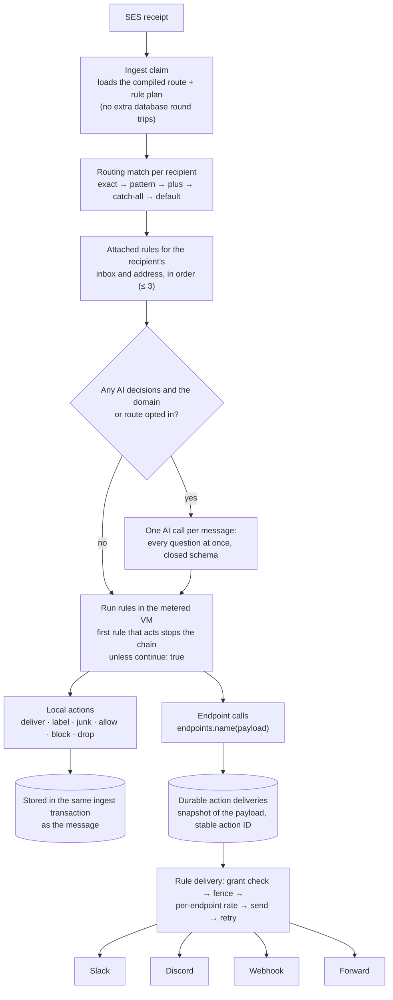
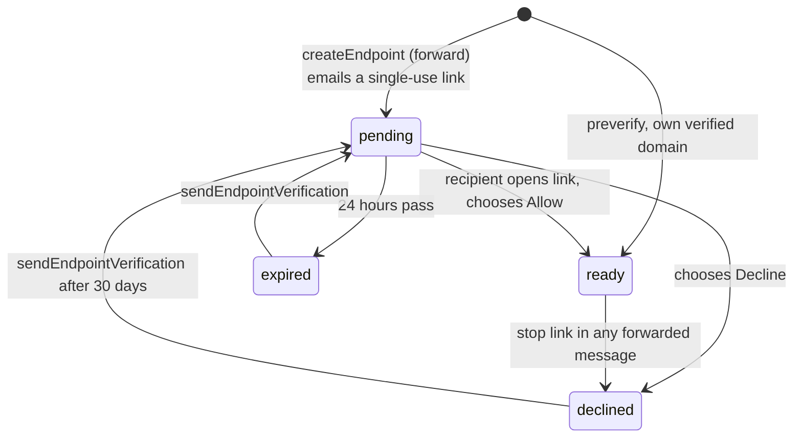

# Rules, Endpoints and AI decisions

A **rule** is a short script that runs when mail reaches an inbox or address. It reads the message and chooses its **actions**: deliver it to another inbox, call an endpoint, label it, junk it, block it. An **endpoint** is a named Slack, Discord, webhook or forward target that rules call by name; a route can also deliver to a webhook or forward directly. An **AI decision** is a question a rule asks Nightmail's AI about the message; the answer comes back as a plain score or boolean.


In the dashboard, rules and destinations (the API's endpoints) are tabs of **Receiving**, next to Addresses. [receiving.md](receiving.md) explains how they fit together. The Rules tab lists every rule as a sentence ("Post new mail to support in Slack"), with its addresses, when it last matched, an on/off switch and a menu (Edit, Delete). A rule has one page, its code, whatever made it: the name, the addresses it runs on (their order and **Run the next one too** open from that line), Undo, Save and a menu (Turn off, Sender lists and AI access, Delete rule). Save writes the code, the addresses and on or off as one version. **New rule** offers splitting an address's mail two ways (**Split by words**, **Split by meaning**: the address builder, on the address it came from or the one chosen next), then the [recipes](#recipes); under **Advanced**, **Write code** opens the editor and **Ask your agent** has an agent write one.

Rules were called rituals, and AI decisions omens, until November 2026. The earlier names still work in the API as deprecated aliases: see [Earlier names](#earlier-names).

- [Concepts](#concepts), [recipes](#recipes) and [the pipeline](#the-pipeline)
- [Language reference](#language-reference): [entry point](#entry-point), [what you can write](#what-you-can-write), [`email` and `ctx`](#email-and-ctx), [built-ins](#built-ins), [endpoints](#calling-endpoints), [AI decisions](#ai-decisions), [sender lists](#sender-lists), [limits](#limits), [errors](#compile-errors)
- [Examples](#examples)
- [Endpoints](#endpoints): types, [forward confirmation](#forward-confirmation), [retries and rate limits](#retries-and-rate-limits)
- [API, SDK and MCP](#api-sdk-and-mcp) and [earlier names](#earlier-names)

## Concepts

| Thing | What it is | Where it lives |
|---|---|---|
| Rule | A script with one default function `route(email, ctx)`. Deterministic: no clock, randomness, loops or network. | Saved by key in a versioned workspace config (`applyRules`, `saveRule`). |
| Attachment | Runs a rule on mail to a target: an inbox ID (`mbx_…`) or an address. Ordered; up to 10 per target. | Same config (`attachRules`). |
| Recipe | A ready-made rule with one or two fields, such as Post to Slack or Block senders. It writes an ordinary script; the rule keeps `recipe: { id, params }` while its source is what the recipe wrote. | `listRuleRecipes`, `createRuleFromRecipe`, `updateRuleFromRecipe`. |
| Endpoint | A named target: `slack`, `discord`, `webhook` or `forward`. Credentials and URLs stay in the endpoint; scripts only name it. | `/v1/endpoints`. |
| AI decision | A literal question in a rule, such as `"Is the sender asking for a refund?"`. One AI call per message answers every question; scripts get numbers or booleans. | Declared in the source with `decisions(…)`; asked only for domains or routes opted in with `setDecisionOptIns`. |
| Sender list | A named list of addresses or `@domains` for `lists.has(name, address)`. | Same config (`senderLists`). |

A rule can be turned off (`updateRule` with `enabled: false`): it keeps its source and attachments and doesn't run until it is turned on. The config stores `enabled: false` only; omitted means on.

Routing still sets where mail goes by default (routes and inbox ownership). Rules run on top of that for each recipient and can add destinations, call endpoints, or change the message's disposition. Guard is part of this: blocking, allowing and junking are ordinary rule actions, with templates for the common cases.

## Recipes

A recipe is a sentence with blanks. Filling them in writes the rule's script, and that script runs like any other: recipes change nothing about how rules run.

| Group | Recipe (`id`) | Fields | Writes |
|---|---|---|---|
| Tell your team | Post to Slack (`slack`), Post to Discord (`discord`) | `channel`: a Slack or Discord endpoint | `if (ctx.junk) return`, then a post with the sender and subject |
| Pass it on | Forward (`forward`), Send to your app (`webhook`) | `to`: a confirmed forward; `app`: a webhook endpoint | `if (ctx.junk) return`, then the endpoint call |
| Keep out junk | Junk newsletters (`junk-newsletters`), Block senders (`block-senders`), Always let VIPs in (`allow-senders`), Junk failed DMARC (`junk-failed-dmarc`) | `senders`: addresses and `@domains`, up to 100 | `junk`, `block` or `allow` plus the `vip` label |
| Sort with AI | Label by meaning (`label-by-meaning`), Alert by meaning (`alert-by-meaning`) | `meaning`, like `a refund request`; `label`, or `channel`: a Slack or Discord endpoint | an AI decision, `Does this email look like a refund request?`, acted on at 0.7 |

- **Create.** `createRuleFromRecipe` takes `recipe`, `params` and `addresses` (inbox IDs or addresses, 1 to 10). The key is the recipe and the first address's local part (`slack-support`, then `slack-support-2`) unless `key` is given. Endpoint fields name an endpoint that already exists (`createEndpoint` first); the dashboard's form creates it inline.
- **Order.** A recipe's attachment runs with **Run the next one too** on, after the address's other recipes and before its scripts: keep-out recipes first, then allow-lists, then the rest. A script's "stop the rest" never silences a recipe.
- **AI recipes** add their addresses' domains to the AI decision opt-in (`evaluateDomains`). AI rules are free (`decisionPricePerThousand` in `listRuleRecipes` is deprecated and always `"0.00"`).
- **Edit.** `updateRuleFromRecipe` rewrites the script from new fields; `addresses`, when given, replaces where it runs (addresses kept stay in place). Saving a different source with `saveRule` or `applyRules` makes the rule a script: its `recipe` is dropped. The dashboard opens every rule as its code, so saving an edit there does this; for a two-way rule (the address builder's) it asks first, because the builder can no longer change it. Passing `recipe` to `updateRuleFromRecipe` turns a script into that recipe. An AI recipe saved before the rename wrote `omens(…)` where it now writes `decisions(…)`; it keeps its recipe, and the next recipe edit rewrites it.
- **Two-way rules.** Two recipes are not in `listRuleRecipes`: the dashboard's address builder writes them, and `createRuleFromRecipe` and `updateRuleFromRecipe` take them. `split` checks one thing (`test`: `always`, `from`, `subject`, `text` or `attachment`; `value`: the words to look for, or addresses and @domains for `from`) and sends matching mail to `then` and the rest to `otherwise` (`always` has no `otherwise`). `split-by-meaning` asks the AI whether the email looks like `meaning`. A side is `inbox:<key>`, an endpoint name, `store` or `drop`; an endpoint side skips junk. The address they run on gets the route `[]`, so each side gets exactly its destination. `setInboundAddressFlow` changes an address's route and its two-way rule together, in one version (taking the last rule that asks the AI off a domain takes that domain off `evaluateDomains`), and `createInboundAddress` takes the same `flow` for a new address.
- **Last matched.** Ingest records which rules took an action on each email (`verdicts.ritualsActed`). `getInboundOverview` lists every rule with `recipe`, `enabled`, `addresses` and `lastMatchedAt`, the newest of the workspace's last 1,000 received emails it acted on.

## The pipeline



- A rule error stops evaluation for that recipient. Nightmail discards pending rule actions, marks the message as junk with `ritual-error` (the label keeps its name from before the rename), and uses the existing junk delivery rules. Rule text and regex operations inspect at most the first 65,536 characters. A regex test also spends one step for every 64 bytes of matcher state it builds; a pattern that needs more than 512 KiB of state for a text (many wildcards in a row, for example) is a rule error for that message, so prefer `includes`, anchors and specific words over long runs of `.`.
- Local actions commit with the message, so nobody sees mail before its final disposition. External calls are queued only after that commit.
- A dry run (`testRules`) runs the same pipeline on a stored message or pasted MIME inside a rolled-back transaction. It never delivers, never asks the AI and never saves; pass `scores` (or set answers in the dashboard) to see what an AI decision's answer would do.

### Stepping through a dry run

Each trace row has a `timeline`: the evaluation in the order it happened, at most 128 steps. Dry runs record it; delivery never does.

| Step | Fields | Meaning |
|---|---|---|
| `condition` | `line`, `column`, `endLine`, `endColumn`, `result` | An `if` or `?:` test, its source span and what it evaluated to. |
| `decisions` | `line`, `scores` | The AI decision answers the rule read: the `scores` you passed, recorded answers, or each decision's `onError` value. |
| `action` | `line`, `op`, `ref?`, `value?` | `label`, `junk`, `block`, `drop`, `allow`, `inbox.deliver` (`ref: inbox:<key>`) or an endpoint call (`ref: endpoint:<name>`). |
| `return` | `line` | The `return` that ended the rule. |

For this rule and a refund request, with the AI decision answered `0.9`:

```js
const QUESTIONS = { refund: "Is the sender asking for a refund?" }

export default function route(email, ctx) {
  if (email.headers.has("list-unsubscribe")) return junk("newsletter")
  const result = decisions(email, QUESTIONS)
  if (result.refund >= 0.7) {
    label("refund")
    inbox.deliver("billing")
  }
  endpoints.support({ text: `${email.from.address}: ${email.subject}` })
}
```

```json
[
  { "kind": "condition", "line": 4, "column": 7, "endLine": 4, "endColumn": 44, "result": false },
  { "kind": "decisions", "line": 5, "scores": { "refund": 0.9 } },
  { "kind": "condition", "line": 6, "column": 7, "endLine": 6, "endColumn": 27, "result": true },
  { "kind": "action", "line": 7, "op": "label", "value": "refund" },
  { "kind": "action", "line": 8, "op": "inbox.deliver", "ref": "inbox:billing" },
  { "kind": "action", "line": 10, "op": "endpoint", "ref": "endpoint:support" }
]
```

The dashboard animates it. **Trace** (Receiving → Trace) runs a recent email, a sample or a pasted message through the saved config. Conditions light up true or false in the source one at a time, AI decision scores fill in, then the actions and where the mail ends up. Reduced motion shows the result at once.

**Try on recent mail** on a rule's page (⌘↵) runs only the rule you're writing, unsaved, on recent emails to its addresses, each as if the rule were attached to the address the email was sent to and with the AI answer the email got when it arrived. Each email shows what the draft does to it; one the draft treats differently from the saved rule is marked, and an email opens to its address and the AI's answer. Nothing runs while it is closed.


## Language reference

### Entry point

```js
export default function route(email, ctx) {
  // one run per recipient
}
```

The parameters are always `email` and `ctx` (`ctx` is optional). Top-level `const` is allowed only for literal question sets: `const QUESTIONS = { refund: "Is this a refund request?" }`.

### What you can write

| Allowed | Not available (and the compile error says why) |
|---|---|
| `const name = …` (one per statement) | `let`, `var`, assignment, `++` |
| `if` / `else`, `cond ? a : b`, `return` | loops, `switch`, `try`, `throw` |
| `===` `!==` `<` `<=` `>` `>=` `+` `&&` `\|\|` `??` `!` | `==`, `!=`, other operators |
| Strings, numbers, `true`/`false`/`null`, template strings, arrays, record literals | functions, classes, `new`, `await`, spread, destructuring |
| `text.includes(x)`, `.startsWith`, `.endsWith`, `.toLowerCase()`, `.toUpperCase()`, `.trim()`, `.length` | other methods (`split`, `map`, …) |
| `/pattern/flags.test(text)` (RE2: linear time, flags `imsu`, no `{n,m}`) | regex literals used any other way |
| `email.x.y`, `email.to[0].address`, `email["field"]` | computed lookups like `value[key]` |

### `email` and `ctx`

`email` is the parsed message. Field access is checked when you save: `email.subjet` fails with *Did you mean email.subject?*

| Field | Type | Notes |
|---|---|---|
| `subject`, `text`, `visibleText`, `html` | string | `visibleText` drops hidden content (64 KiB max). `html` is sanitized or `null`. |
| `from` | `{ name, address, local, domain }` | `name` is unverified unless `auth.fromVerified`. |
| `to`, `cc`, `replyTo` | arrays of the same shape | |
| `envelope` | `{ from, to[] }` | SMTP envelope. |
| `auth` | `{ fromVerified, spf, dkim, dmarc }` | `fromVerified` is true when DMARC-aligned SPF or DKIM authenticates the From domain. Verdicts are `pass`, `fail`, `gray` or `none`. |
| `spam` | `{ ses, junk, reason }` | `junk` is Nightmail's verdict so far. |
| `flags` | `{ automated, autoReply, bulk, listId, forwardHops }` | |
| `thread` | `{ id, isReply, inReplyTo, references[] }` | |
| `attachments`, `images` | `{ id, filename, contentType, size, inline, isImage, safe, … }[]` | Metadata only; content never reaches a rule. |
| `links` | string[] | Visible links. |
| `headers` | use `email.headers.get(name)`, `.getAll(name)`, `.has(name)` | Names are case-insensitive. |
| `id`, `messageId`, `date`, `receivedAt`, `size`, `parsed`, `truncated` | | |

`ctx` describes the recipient this run is for: `recipient`, `local`, `host`, `subaddress`, `route.id`, `route.tier`, `defaults` (destinations routing chose), `junk`, `now` (receipt time; there is no clock).

The full, typed list for your workspace (including your endpoint names, inbox keys and lists) is `getRuleTypings`; the dashboard editor uses it for completions.

### Built-ins

| Call | Effect |
|---|---|
| `block(reason?)` | Reject for this recipient. Nothing is stored or delivered for it. |
| `drop(reason?)` | Discard for this recipient without storing it. |
| `junk(reason?)` | Store as junk. Webhooks without junk include skip it. |
| `allow()` | Clear the junk flag. Ignored unless `email.auth.fromVerified`. |
| `label(name)` | Add a label (up to 10; letters, digits, `:`, `-`, `_`). |
| `inbox.deliver(key)` | Also deliver to the inbox with this key. |
| `endpoints.<name>(payload?)` | Call an endpoint ([below](#calling-endpoints)). |
| `decisions(email, { name: question })` | Ask the AI ([below](#ai-decisions)). |
| `lists.has(list, address)` | True when the list has the address or an `@domain` that covers it. |
| `addr.matches(address, pattern)` | Glob on addresses: `"*@example.com"`, `"billing+*@acme.io"`. |
| `text.snippet(text, maxChars)` | First `maxChars` characters (≤ 4,096). |

The first rule that takes an action stops the chain for that target unless its attachment sets `continue: true`.

### Calling endpoints

Every endpoint is called the same way, by name; its type decides the payload, and the payload is checked when you save.

| Type | Call | Payload |
|---|---|---|
| `slack` | `endpoints.support({ text: "…" })` | Plain text. Mentions, markup and link previews are off. |
| `discord` | `endpoints.alerts({ content: "…" })` | Plain text. Mentions are off. |
| `webhook` | `endpoints.crm({ … })` or `endpoints.crm()` | Any record: it arrives as the signed request's JSON body, with `Idempotency-Key`. Without one, the webhook gets the `message.received` event. |
| `forward` | `endpoints.team()` | None: it forwards this message whole (text, HTML and attachments) from the receiving address. |

Hyphenated names use quotes: `endpoints["support-hook"]({ … })`. A script can never contain a URL or credential; saving fails if it does. An endpoint must exist (and a forward must be confirmed) before a rule that calls it can be saved. Each endpoint can be called at most three times per recipient of a message.

### AI decisions

```js
const result = decisions(email, {
  refund: "Is the sender asking for a refund?",                                  // score 0–1
  urgent: { prompt: "Does this need a reply today?", type: "boolean", threshold: 0.8 },
})
if (result.refund >= 0.7) label("refund")
if (result.urgent) endpoints.oncall({ text: email.subject })
```

- Questions are literal text, fixed when you save, so a message cannot change what is asked. Answers are plain data: use them in any condition.
- The AI sees the subject, sender, authentication verdicts and up to 8,000 characters of visible text, framed as untrusted evidence. It answers only the declared questions with a closed schema.
- AI decisions are asked only for opted-in receiving domains or routes. Their attachments may reference at most ten distinct questions across the plan. When the AI cannot answer, the configured `onError` applies. `"defer"` retries for up to 30 minutes from receipt creation, then marks that recipient’s message as junk with `ritual-error`.
- One call per message answers every question across every rule (up to ten). Dry runs reuse the stored answers or the `scores` you pass, and never ask the AI.
- AI rules are free. Each call is counted on the `omen` meter (`getBillingUsage` with `meter=decision`) but not charged.
- `omens(email, …)`, the function's name before the rename, compiles to the same plan: stored sources that use it keep working unchanged.

### Sender lists

```js
if (lists.has("vip", email.from.address)) allow()
```

Lists live in the config: `"senderLists": { "vip": ["ceo@example.com", "@partner.example"] }`. A list a rule names must exist when you save.

### Limits

| Limit | Value |
|---|---|
| Source | 64 KiB per rule, 50 rules, 256 attachments, 10 per target |
| Steps | 50,000 per run, 250,000 per message |
| Actions | 32 per run; three calls per endpoint per recipient |
| Output | 64 KiB per action, 256 KiB per message |
| AI decisions | 10 per rule, 10 distinct questions per message |
| Regex | 256 characters, 512 RE2 instructions, 64 Ki characters of input, 512 KiB of matcher state per test |

Measured cost on a warm plan is 4–6 µs of CPU per message for typical rules (`NIGHTMAIL_BENCH=1` runs the benchmark).

### Compile errors


The editor checks as you type (`checkRule`). Saving and dry runs report every problem at once, each with the rule, line, column and a hint:

```json
{
  "error": {
    "code": "UNKNOWN_ENDPOINT",
    "message": "Rule triage, line 4, column 3: No endpoint named suport. Did you mean endpoints.support? (and 1 more in error.details)",
    "details": [
      { "rule": "triage", "line": 4, "column": 3, "message": "No endpoint named suport.", "hint": "Did you mean endpoints.support?" },
      { "rule": "triage", "line": 6, "column": 7, "message": "email has no field subjet.", "hint": "Did you mean email.subject?" }
    ]
  }
}
```

Other examples: `slack.billing(…)` → *Endpoints are called by name, whatever their type. Write endpoints.billing({ text }).* · `for (…)` → *Loops are not available; a rule runs once per recipient within a fixed step budget.* · `x == 1` → *Use === instead of ==.* · `endpoints.alerts({ text })` on a Discord endpoint → *call it as endpoints.alerts({ content }).*

## Examples

These are the built-in templates (`listRuleTemplates` fills in your endpoint names). Each one compiles; the test suite checks it.

**Post authenticated mail to Slack**

```js
export default function route(email, ctx) {
  if (!email.auth.fromVerified) return
  endpoints.support({ text: `New mail from ${email.from.address}: ${email.subject}` })
}
```

**Send a reshaped record to your service**

```js
export default function route(email, ctx) {
  endpoints.crm({
    sender: email.from.address,
    verified: email.auth.fromVerified,
    subject: email.subject,
    preview: text.snippet(email.visibleText, 280),
    recipient: ctx.recipient,
  })
}
```

**Forward to a team address** (the recipient confirmed by email)

```js
export default function route(email, ctx) {
  if (email.auth.fromVerified && !email.flags.bulk) endpoints.team()
}
```

**Guard: block a domain, keep VIPs, junk newsletters and failed DMARC**

```js
export default function route(email, ctx) {
  if (email.from.domain === "spam.example") return block("blocked domain")
  if (lists.has("vip", email.from.address)) {
    allow()
    return label("vip")
  }
  if (email.headers.has("list-unsubscribe") || email.flags.bulk) junk("newsletter")
  if (email.auth.dmarc === "fail") junk("DMARC failed")
}
```

**Label refunds and alert on Discord**

```js
const QUESTIONS = { refund: "Is the sender asking for a refund?" }

export default function route(email, ctx) {
  const result = decisions(email, QUESTIONS)
  if (result.refund < 0.7) return
  label("refund")
  endpoints.alerts({ content: `Refund request from ${email.from.address}: ${email.subject}` })
}
```

**Route by subaddress**

```js
export default function route(email, ctx) {
  if (ctx.subaddress === "billing") inbox.deliver("billing")
  else if (addr.matches(email.from.address, "*@vendor.example")) inbox.deliver("vendors")
}
```

**Triage with a second, stricter check**

```js
export default function route(email, ctx) {
  const first = decisions(email, { urgent: { prompt: "Does this need a reply today?", type: "boolean", threshold: 0.6 } })
  if (!first.urgent) return
  const second = decisions(email, { outage: { prompt: "Is the sender reporting a service outage?", type: "boolean", threshold: 0.8 } })
  label(second.outage ? "outage" : "urgent")
  if (second.outage) endpoints.oncall({ text: `Outage report: ${email.subject}` })
}
```

Both `decisions(…)` calls are answered by the same single AI request.

## Endpoints


`createEndpoint` takes a `type` and a `name` (lowercase letters, digits and hyphens, unique across all types):

| Type | Fields | Ready when |
|---|---|---|
| `slack` | `url`: the incoming webhook URL | Created. The URL is a credential: stored encrypted, pinned to `hooks.slack.com`, never returned. |
| `discord` | `url`: the webhook URL | Created. Same handling, pinned to `discord.com`. |
| `webhook` | `url`, optional `headers`, `timeoutSeconds`, `retryAttempts` | Created. Returns its signing secret once. It is also usable from routes as `webhook:<name>`. |
| `forward` | `address`, optional `from` (the receiving address that asks), `preverify` | The recipient chooses Allow in the emailed link, or at once with `preverify` for an address on a domain this workspace verified. Routes then deliver to it as `forward:<name>` (or its `con_…` ID), with no rule. |

`getEndpoint` returns `status` (`ready`, `pending`, `expired`, `declined`, `paused`) and a `nextStep` for people and agents. `updateEndpoint` changes the rate, retry policy, pause state or URL; `testEndpoint` posts a fixed test message; `deleteEndpoint` refuses while a rule or route uses it. Endpoint URLs are write-only, so a Slack, Discord or webhook endpoint that was paused because the approval that created or changed it was removed resumes only after its URL is sent again: `updateEndpoint { "url": "…", "paused": false }` (`ENDPOINT_URL_REQUIRED` otherwise, also for `testEndpoint`). A forward paused the same way resumes with `{ "paused": false }`: its address is shown and cannot change.

### Forward confirmation




- **The link alone confirms.** No Nightmail account is needed: team aliases and external addresses work. The token is a random 256-bit value, stored only as a hash, valid once for 24 hours.
- **The workspace cannot confirm for the recipient.** The confirmation email is sealed: the copy in the workspace's sent mail, thread view and email content API shows the link as withheld.
- **Scanners cannot confirm.** Opening the link only shows the request; a same-origin form POST records the choice.
- **Abuse limits.** 20 requests per workspace per day, 3 per address per workspace per day and 5 per address per day across all workspaces. Declining, or the stop link in any forwarded message, blocks that workspace from asking the address again for 30 days.
- **What is forwarded.** Only mail that passed the virus scan, is not junk, automated or a mailing list, and did not fail DMARC (decided once at ingest as `verdicts.forwardEligible`); loops are refused (any `X-Nightmail-Loop`, or the earlier `X-Bane-Loop`), and each message is forwarded once per endpoint, whether a rule, a route or both send it there. A forward is sent and billed like any other mail from that address, so the workspace's sending limits apply to it and there is no separate daily budget; each endpoint forwards at most 1,000 an hour (`429 FORWARD_LIMIT`), which stops a runaway loop.
- **Whole messages.** A forward carries the message's text, its HTML through the same allow-list as every received HTML passed on (formatting, links, tables and inline `cid:` images stay; scripts, forms, styles and remote embeds don't) and its attachments, inline images included. Attachments go along up to what one sent message may carry, in their order: 100 files and 25 MiB decoded in all. Any other, and any type SES won't deliver (such as `.exe`), is named at the end of the forward instead. On hosted Nightmail a forwarded file is someone else's, so each must also pass the content screen's attachment check whatever the sender's standing (a standard image, PDF, office document, archive, audio, video or plain-text file whose name, type and content agree; inline files only as raster images), or it is named instead. A message stored only in part (`bodyTruncated`) says so there too.
- **Headers.** From is the receiving address the mail was sent to (or, for a route on a pattern, catch-all or an address without an inbox of its own, the one that asked the recipient to confirm), with the original sender in the display name (`Ana via support`); Reply-To is the original Reply-To or From, so a reply reaches the sender. SES signs with the workspace's domain, so SPF and DKIM align with From and the forward passes DMARC whatever the original sender's policy. Keeping the original From with `Resent-*` fields would fail DMARC (a `p=reject` sender's mail would be refused), and SES sends only from verified identities. Every forward carries `Auto-Submitted: auto-generated` and a signed `X-Nightmail-Loop` token, and either one stops a message from being forwarded again, so a forward that comes back (A to B and B to A, through another installation or a forwarder that keeps headers) ends there. A forward to a receiving host of the workspace itself is refused when it is created (`FORWARD_LOOP`).

### Retries and rate limits

Every endpoint call goes through one delivery path:

```mermaid
sequenceDiagram
  participant Q as Action delivery (queued)
  participant D as Rule delivery
  participant E as Endpoint
  Q->>D: attempt n (stable action ID)
  D->>D: approval still active? (MCP-created rules)
  D->>D: fence: already delivered → done; unknown outcome → replay only if allowed
  D->>D: per-endpoint rate slot (else wait for the next minute)
  D->>E: POST (webhooks get Idempotency-Key: action ID)
  alt 2xx
    E-->>D: delivered
  else 408, 429 or 5xx
    E-->>D: Retry-After?
    D-->>Q: retry after max(backoff with jitter, Retry-After)
  else timeout or dropped connection
    D-->>Q: retry only if idempotent or retryOnTimeout
  else other 4xx
    D-->>Q: failed, not retried
  end
```

| | Slack | Discord | Webhook | Forward |
|---|---|---|---|---|
| Calls per minute (default) | 60 | 30 | 600 | 60 |
| Replays an unknown outcome | only with `retryOnTimeout` | only with `retryOnTimeout` | with `retryOnTimeout` or `idempotent` | always (deduplicated in the send transaction) |

Backoff starts at 15 seconds and grows ×4 up to 12 hours, with ±25% jitter, never sooner than `Retry-After` (seconds, decimals or an HTTP date). The attempt limit is the endpoint's `retryAttempts` (default 9). Every action has an ID that stays the same across retries.

## API, SDK and MCP

| Task | Operation (also the MCP tool name) |
|---|---|
| Read the config | `getRules`, `getRule`, `listRuleVersions` |
| Check a source while editing | `checkRule` |
| Save | `saveRule`, `applyRules` (whole config), `attachRules`, `deleteRule`, `restoreRuleVersion` |
| Recipes | `listRuleRecipes`, `createRuleFromRecipe`, `updateRuleFromRecipe` |
| Turn on or off | `updateRule` (`enabled`) |
| Dry run | `testRules` (`messageId` or `mime`, optional `config`, `scores`); each trace row has a step-by-step `timeline` |
| Typings and templates | `getRuleTypings`, `listRuleTemplates` |
| AI decision opt-in | `setDecisionOptIns` |
| Endpoints | `listEndpoints`, `getEndpoint`, `createEndpoint`, `updateEndpoint`, `deleteEndpoint`, `sendEndpointVerification`, `testEndpoint` |

The config is `{ rules, attachments: [{ rule, target, continue }], senderLists, evaluateDomains, evaluateRoutes }`. Writes take `If-Match` with the version you read (MCP: `ifMatch`) and fail with `VERSION_CONFLICT` if it changed; without it, a recipe or on/off write applies to the latest version, since it changes only that rule. Creates take `Idempotency-Key` (MCP: `idempotencyKey`). Over MCP these tools are in the `rules` and `endpoints` toolsets and need an owner or admin's approval with `manage`; rules, endpoints and keys an agent creates stop working when that approval is revoked. See [docs/mcp-coverage.md](mcp-coverage.md).

```sh
curl -X POST "$NIGHTMAIL/v1/rules/check" -H "Authorization: Bearer $KEY" -H 'Content-Type: application/json' \
  -d '{"source":"export default function route(email){ endpoints.support({ text: email.subject }) }"}'
```

```ts
import { saveRule, attachRules } from '@nightmail/sdk'
import { createClient } from '@nightmail/sdk/client'
const client = createClient({ baseUrl: 'https://nightmail.dev', auth: () => process.env.NIGHTMAIL_API_KEY })
await saveRule({ client, path: { key: 'triage' }, body: { key: 'triage', source } })
await attachRules({ client, body: { attachments: [{ rule: 'triage', target: 'mbx_…', continue: false }] } })
```

### Earlier names

Rules were called rituals, and AI decisions omens, until November 2026. The deprecated `/v1/rituals` aliases and their MCP tools under the earlier names are gone; use the rule operations above.

- **Writes** still take the earlier spelling of the config: `rituals` for `rules`, and in each attachment `ritual` for `rule`, never both at once. Reads answer `rules`, `rule` and `decisions`.
- **Typings:** the rule typings also declare `omens` and `Omen`, deprecated, so a source that still calls `omens(…)` type-checks.
- **Other responses:** `getInboundOverview` and `listInboundEndpoints` return `rules` (with `decisions`) and keep `rituals` (with `omens`) as deprecated copies; billing returns `prices.decisionPerThousand` and keeps `omenPerThousand` (both deprecated and `"0.00"`: AI decisions are free). The usage meter for AI decisions keeps its value, `omen` (`getBillingUsage` also takes `meter=decision`).
- **Kept names:** the `ritual-error` label on mail a failed rule junked, `verdicts.ritualsActed` and `ritualScores` on stored messages, and Activity's `ritual.*` actions keep their names: they are stored data. The MCP `toolsets=rituals` filter selects the `rules` toolset.
